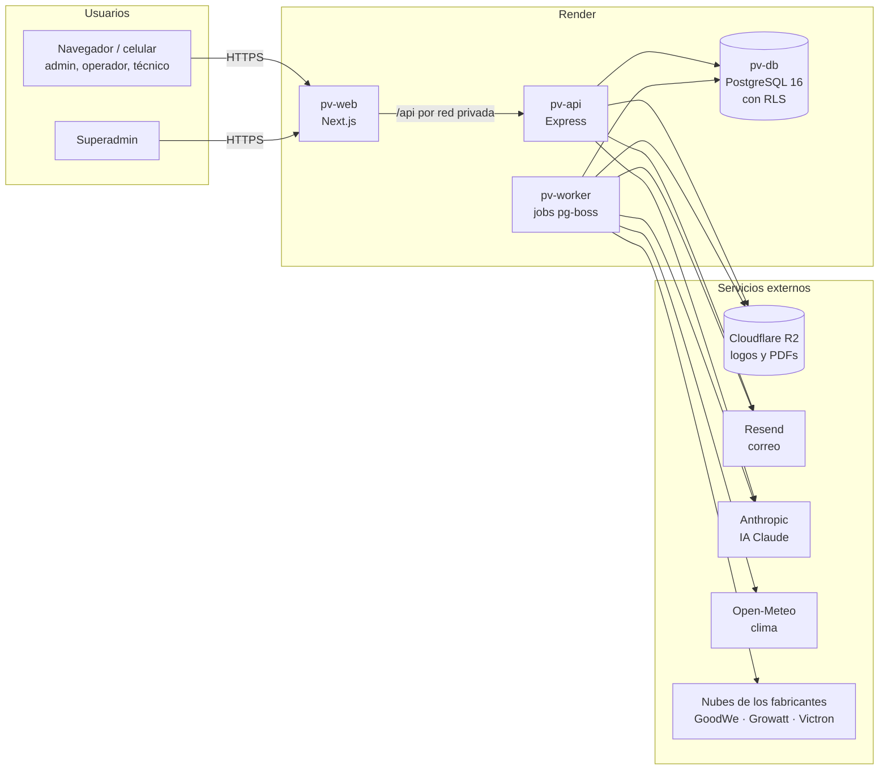
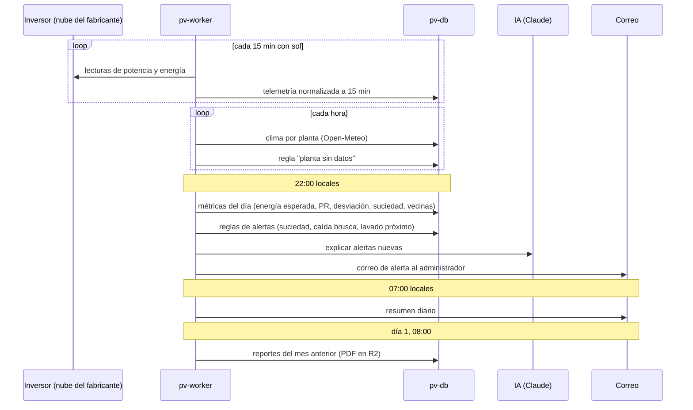

# Arquitectura de PV-IoT

PV-IoT es una plataforma web **multiempresa**: muchas empresas instaladoras la usan al mismo tiempo, y cada una solo ve sus propios datos. La definición completa está en `specs/` (este documento es el resumen para leerlo de una vez).

## 1. Vista general



| Pieza                    | Qué hace                                                                                                                                                                                                      |
| ------------------------ | ------------------------------------------------------------------------------------------------------------------------------------------------------------------------------------------------------------- |
| **pv-web**               | La interfaz (pantallas). Reenvía todo lo que empieza con `/api` a `pv-api` por la red privada de Render, así el navegador ve un solo sitio y la sesión es segura.                                             |
| **pv-api**               | Recibe las peticiones de la interfaz: inicio de sesión, plantas, alertas, tickets, reportes, asistente. Valida permisos y datos en cada petición. Antes de cada despliegue aplica las migraciones de la base. |
| **pv-worker**            | Hace el trabajo de fondo con horario: lee los inversores, descarga el clima, calcula el rendimiento, abre alertas, pide explicaciones a la IA, genera reportes y manda correos.                               |
| **pv-db**                | PostgreSQL. Guarda todo. Aísla a las empresas con _Row Level Security_: aunque una consulta olvidara filtrar, la base solo devuelve filas de la empresa de la sesión.                                         |
| **R2**                   | Archivos: logos de las empresas y PDFs de los reportes. Privado; la API los entrega con permisos.                                                                                                             |
| **Resend**               | Envío de correos: invitaciones, recuperación de contraseña, alertas, resumen diario y reportes a clientes.                                                                                                    |
| **Anthropic (Claude)**   | Explica alertas, redacta la narrativa de los reportes y responde el asistente. Nunca recibe teléfonos, correos, domicilios ni credenciales.                                                                   |
| **Open-Meteo**           | Clima por hora (irradiancia en el plano del panel y temperatura) para calcular cuánto _debería_ generar cada planta.                                                                                          |
| **Nubes de fabricantes** | Donde cada inversor manda sus datos por Wi-Fi. PV-IoT los lee de ahí con la API de cada marca (adaptadores pendientes de documentación oficial; hoy funciona el simulador).                                   |

## 2. Código (monorepo)

```
apps/
  web/      pantallas (Next.js 16, React, Tailwind, Recharts, Leaflet)
  api/      API REST (Express 5, zod)
  worker/   jobs con horario (pg-boss)
packages/
  core/     fórmulas y reglas puras: rendimiento, alertas, reportes, tiempos de tickets
  db/       esquema Prisma, migraciones, RLS, withTenant
  adapters/ inversores, clima, correo, almacenamiento, cola de jobs
  ai/       proveedor de IA, herramientas del asistente, explicaciones, narrativa
  config/   variables de entorno validadas
specs/      la definición del producto (manda sobre el código)
docs/       guías: despliegue, arquitectura, glosario, pantallas
```

Reglas de diseño:

- **Las fórmulas son funciones puras en `packages/core`**, con pruebas. La API, el worker y la interfaz usan las mismas.
- **Todo dato que entra se valida con zod**: peticiones HTTP, jobs, respuestas de la IA y de los proveedores.
- **La IA nunca escribe SQL.** Solo llama a 11 herramientas definidas que ya filtran por empresa.

## 3. Aislamiento entre empresas (dos capas)

1. **Aplicación:** toda consulta de datos de una empresa pasa por `withTenant(empresa)`, que agrega `company_id` a cada consulta. La empresa sale de la sesión, nunca de lo que mande el navegador ni de la IA.
2. **Base de datos:** `withTenant` fija `app.company_id` en la transacción, y las políticas RLS solo dejan ver filas de esa empresa. La aplicación se conecta con un usuario (`pv_app_login`) que no puede saltarse RLS; si se configura con el usuario dueño, se niega a arrancar.

Una prueba automática recorre **todas** las rutas de la API y verifica que un usuario de la empresa A recibe 404 al pedir un recurso de la empresa B, y que ninguna lista trae datos ajenos.

## 4. Cómo fluyen los datos (un día normal)



## 5. Jobs del worker

| Job                                                     | Cuándo                                 | Qué hace                                        |
| ------------------------------------------------------- | -------------------------------------- | ----------------------------------------------- |
| `worker.heartbeat`                                      | cada 5 min                             | Señal de vida (Salud del sistema)               |
| `ingest.telemetry` → `ingest.telemetry_plant`           | cada 15 min, solo con sol              | Lee cada inversor y guarda intervalos de 15 min |
| `ingest.weather` → `ingest.weather_company`             | cada hora (:05)                        | Clima de cada planta                            |
| `weather.backfill`                                      | al crear o mover una planta            | 90 días de clima histórico                      |
| `alerts.offline` → `alerts.offline_company`             | cada hora (:20)                        | Planta sin datos con sol                        |
| `metrics.daily` → `metrics.daily_company`               | 22:00 locales                          | Métricas del día de cada planta                 |
| `alerts.evaluate`                                       | después de las métricas                | Suciedad, caída brusca, lavado próximo          |
| `metrics.recompute`                                     | a mano                                 | Recalcula un rango de días                      |
| `ai.explain_alert`                                      | al abrir una alerta                    | Explicación con IA (o plantilla)                |
| `notifications.send`                                    | por evento                             | Envía un correo                                 |
| `notifications.daily_summary`                           | 07:00 locales                          | Resumen diario por empresa                      |
| `reports.monthly` → `reports.generate` → `reports.send` | día 1, 08:00                           | Reportes del mes: cifras, narrativa, PDF, envío |
| `telemetry.cleanup`                                     | día 2 de cada mes                      | Borra lecturas de 15 min de más de 13 meses     |
| `demo.example_data`                                     | a pedido del superadmin (solo pruebas) | Datos de ejemplo en una empresa vacía           |

Cada job corre dentro de su empresa, registra cada intento en `job_runs` y se reintenta con espera creciente si falla.

## 6. Seguridad (resumen)

- Contraseñas con argon2id; inicio de sesión con límite de intentos; errores que no revelan si un correo existe.
- Sesión: token de 15 min + cookie de renovación `httpOnly` y `Secure`, rotada y revocable. En cada petición se revisa que el usuario y la empresa sigan activos y se usa el rol vigente.
- Credenciales de inversores cifradas (AES-256-GCM); nunca salen por la API ni en los registros.
- Auditoría de acciones sensibles (inicios de sesión, usuarios, credenciales, umbrales, plantas eliminadas, reportes enviados).
- CI con pruebas, aislamiento, escaneo de secretos (gitleaks) y de dependencias (`pnpm audit`).

## 7. Ambientes

| Ambiente   | Dónde                            | Notas                                  |
| ---------- | -------------------------------- | -------------------------------------- |
| Local      | PostgreSQL local                 | `pnpm dev`, semilla de demo            |
| Staging    | Render (Blueprint `render.yaml`) | Simulador habilitado, datos de ejemplo |
| Producción | Render (otro Blueprint)          | Simulador deshabilitado                |

Guía paso a paso: [`docs/despliegue-render.md`](despliegue-render.md).
